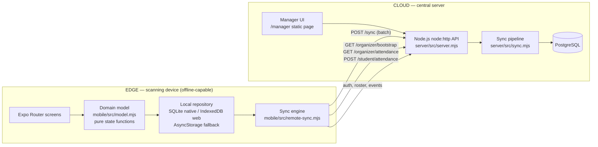

# EdgeSync — System Design

Distilled architecture reference for EdgeSync, the offline-first QR attendance engine.
Keep this file as the single source of truth for *how the system fits together*; implementation
details live in the code and in `SYNC_PROTOCOL.md`.

## 1. Problem & design goals

Traditional web attendance systems fail during large university events: network congestion,
Wi-Fi drops, and throttling stall every scan and lose data. Organizers fall back to pen and
paper.

Design goals:

1. **Zero-downtime scanning** — validation and storage must never depend on the network.
2. **Roster-based verification** — unknown IDs rejected instantly, without live DB queries.
3. **Asynchronous reconciliation** — pending logs push to a central server when connectivity
   returns, without data loss or duplicates.

## 2. Architecture

Three tiers, one rule: **the scan path only ever touches the left box.**

## 3. Components

| Component | Location | Responsibility |
| :--- | :--- | :--- |
| Domain model | `mobile/src/model.mjs` | Pure functions over state: `login`, `checkIn`, `createEvent`, `deleteEvent`, merge helpers. No I/O. |
| Local repository | `mobile/src/local-repository.{js,native.js,web.js}` | Platform-split persistence: expo-sqlite (native), IndexedDB (web, with legacy AsyncStorage migration), AsyncStorage (fallback). |
| Snapshot store | `mobile/src/storage.mjs` | One JSON snapshot per commit; promise queue serializes rapid writes; `migrateData()` upgrades old versions. |
| Sync engine | `mobile/src/remote-sync.mjs` | Collapses pending records, uploads batches to `/sync`, downloads bootstrap/attendance, marks accepted records. |
| Event schedule | `mobile/src/event-schedule.mjs` | Pure time-window logic deciding time-in vs time-out phase. |
| API server | `server/src/server.mjs` | Raw `node:http` routes: auth, roster import, organizer events, attendance refresh, management, `/sync`. Owns the idempotent schema bootstrap at startup. |
| Sync pipeline | `server/src/sync.mjs` | `validateBatch` (limits + shape), `dedupeAttendanceRecords` (pair merge), `saveBatch` (transactional upserts), scrypt password helpers. |
| Postgres schema | `server/src/server.mjs` (CREATE TABLE IF NOT EXISTS) | `organizers`, `organizer_sessions`, `students`, `student_sessions`, `events`, `event_organizers`, `management_audit`, `attendance`, `manager_recovery_codes`, `schema_migrations`. |
| Manager UI | `server/` build → `/manager` | Static page for the system manager (roster, organizers, events, audit). Built with esbuild. |
| Prototype | `prototype/` | Browser prototype + admin auth flow checks (pre-Expo validation of the UX). |

## 4. Data flows

### 4.1 Organizer bootstrap (online → offline)

1. Organizer signs in online → server issues a hashed session token.
2. `GET /organizer/bootstrap` returns assigned events, the full student roster, and existing
   attendance for that organizer's events.
3. `mergeOrganizerBootstrap` merges into local state — preserving locally-created events
   (`createdLocally`) and unsynced records.

### 4.2 Scan / check-in (offline-only)

1. QR code yields a student ID.
2. `checkIn()` validates: admin session, event exists, `eventSchedule` phase allows the action,
   and (for scans) the ID exists in the cached roster (`data.students`).
3. On success, a record `{ id, studentId, …, timeInAt, synced: false }` is prepended and the
   attendee is appended to `event.attendees`.
4. `repository.update()` commits the full snapshot locally. **No network call.**

### 4.3 Time-out (offline-only)

1. After the event end time, `eventSchedule` returns `action: 'time-out'`.
2. `checkIn()` requires an existing time-in record on the device and sets
   `timeOutAt`/`timeOutMethod`, flipping `synced: false`.

### 4.4 Sync upload (online, user-triggered)

1. `syncToServer` filters `records` to `synced: false`.
2. `mergePendingRecords` collapses them per (eventId, studentId) — earliest time-in, earliest
   time-out — so each pair appears once.
3. One `POST /sync` with `{ students, events, records }` (events included when referenced by
   pending records; locally-created events carry `createdLocally: true`).
4. Server replies `{ acceptedRecordIds, conflictRecordIds, acceptedEventIds }`.
5. `markSynced` flips only accepted records to `synced: true` and clears `createdLocally` on
   accepted events.

### 4.5 Attendance refresh (online, pull)

- Organizers: `GET /organizer/attendance` → `mergeOrganizerAttendance` rebuilds
  `event.attendees` from server rows; unsynced local records win over stale server rows.
- Students: `POST /student/attendance` → `mergeStudentAttendance` for personal history,
  plus `mergeStudentEvents` for the shared event feed. Every event is visible to every
  student regardless of the organizing section or year level; the student dashboard
  displays the current event and upcoming events from this feed.

## 5. Design patterns applied

| Pattern | Where in EdgeSync | Why |
| :--- | :--- | :--- |
| **Offline-first** | Whole scan path; network only for bootstrap/sync | Scanning must survive congestion and Wi-Fi drops |
| **Edge computing** | Roster snapshot + validation on the device | Zero-latency rejection of unknown IDs, no DB round-trip |
| **Outbox** | `records[]` with `synced: false` drained by sync | Writes are local and fast; delivery is deferred and retryable |
| **Idempotent consumer** | `UNIQUE (event_id, student_id)` + `ON CONFLICT … LEAST()` upsert | Replaying a batch converges to the same state — no duplicates |
| **Last-writer-wins (earliest-wins variant)** | `LEAST()` on time-in/time-out columns | Concurrent devices merge deterministically; earliest observation is truth |
| **Snapshot state + pure reducers** | `model.mjs` pure functions over one state object | Testable business rules without I/O; atomic commits |
| **Repository pattern** | `local-repository.{native,web}.js` behind one interface | Same domain logic on SQLite, IndexedDB, AsyncStorage |
| **Batch + transaction** | `saveBatch`: `BEGIN` → validate → upsert → `COMMIT` | All-or-nothing reconciliation; rollback on any failure |
| **Eventual consistency** | Local state is authoritative until sync; server converges on upsert | Availability > consistency on the edge |
| **Schema migration** | Versioned local snapshot (`version: 2`) + idempotent `ALTER TABLE … IF NOT EXISTS` at server startup | Safe upgrades of both stores |
| **Audit log** | `management_audit` table | Traceability for manager actions (thesis requirement) |
| **Defense in depth (auth)** | scrypt + salt, `timingSafeEqual`, hashed session tokens, CORS allowlist, role checks per route | Credentials and sessions never stored in plaintext |

## 6. Constraints & invariants

- **Network**: may be absent for hours; assume nothing is reachable during scanning.
- **Devices**: phones/tablets (Expo native) and laptops (PWA). Storage is small but sufficient
  for a roster + event logs.
- **Invariants**:
  - One attendance row per (event, student).
  - A record's `timeOutAt` can only exist if `timeInAt` exists.
  - Records are never removed locally; only marked `synced`.
  - `acceptedRecordIds` alone decides what becomes `synced`.
  - Batch limits: students ≤ 5000, events ≤ 1000, records ≤ 10000.
  - Passwords ≥ 12 chars and ≠ student section.
  - Managers never scan; organizers/students never manage.

## 7. Failure modes & recovery

| Failure | Behavior |
| :--- | :--- |
| Network down during scan | Scans continue; records stay `synced: false`. |
| Sync interrupted (timeout/5xx) | Batch is retryable; pending data stays local (`retryable` error). |
| Session expired during sync (401) | Client keeps pending data and asks the organizer to sign in online again. |
| Two devices scan the same student | Client merges per pair; server upsert keeps earliest time-in/time-out. |
| Duplicate replay of a batch | Idempotent upsert converges — no duplicate rows. |
| Invalid batch shape | `validateBatch` rejects before any write (400). |
| Locally-created event ID collision | Server detects an ID in use by another organizer and rejects with a clear error. |

## 8. Tech stack

| Layer | Technology |
| :--- | :--- |
| Mobile / PWA | Expo SDK 57, Expo Router, React Native 0.86, react-native-web PWA export |
| Local persistence | expo-sqlite (native), IndexedDB (web), AsyncStorage (fallback) |
| QR | expo-camera, react-native-qrcode-svg |
| API server | Node.js `node:http` + `node:crypto`, PostgreSQL via `pg` |
| Roster import | CSV/Excel via `@e965/xlsx` |
| Manager UI | React 19 + esbuild → static page served at `/manager` |
| Quality | Node test runner (`node --test`), ESLint, Playwright, `tsc --noEmit` |

## 9. File map

- `mobile/src/model.mjs` — business rules (read first for domain questions)
- `mobile/src/remote-sync.mjs` — client half of the sync protocol
- `mobile/src/storage.mjs` — snapshot store + migrations
- `server/src/sync.mjs` — server half of the sync protocol
- `server/src/server.mjs` — routes + schema
- `docs/SYNC_PROTOCOL.md` — wire format, dedupe, conflict resolution in detail
- `docs/SOURCES.md` — external canonical references per pattern
